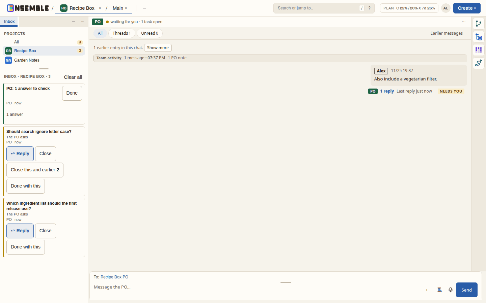

# Ensemble

Ensemble is a local dashboard for projects worked on by coding agents. A project has a product owner (PO) chat and a board of tasks; Claude Code and Codex can own tasks, review changes, report back and carry work across long sessions. The hub runs on your machine and serves a browser page you can open from another device on your tailnet.



## What you can do

- [Plan and track tasks on the board](docs/board.md), with priorities, drafts and workflow columns.
- [Follow a task from draft through review](docs/task-life.md), with owner reports and handovers.
- [Talk to a project's PO](docs/po-chat.md) in threads and track your points.
- [Answer decisions in the Inbox](docs/inbox.md) with choice and Yes/No cards.
- [Read and comment on project files](docs/files.md) and [open live task sessions](docs/sessions.md).
- [Use it remotely](docs/remote-security.md), [watch plan usage](docs/usage.md), and [choose a theme](docs/settings.md).

## Quick start

Get a build from [Releases](https://github.com/fab-ioc/ensemble/releases), or clone the repository and run the platform installer:

```sh
git clone https://github.com/fab-ioc/ensemble.git
cd ensemble
./install-systemd.sh              # Linux: starts a user service
# ./ensemble start                 # macOS: starts the hub in the background
# .\ensemble.ps1 start            # Windows PowerShell
```

Open `http://127.0.0.1:8765` on the hub machine. Install and login to Claude Code or Codex before starting agent work. See [Getting started](docs/getting-started.md) for platform details and your first project.

[User guide](docs/README.md) · [Contributor guide](docs/developer.md) · [MIT license](LICENSE)
