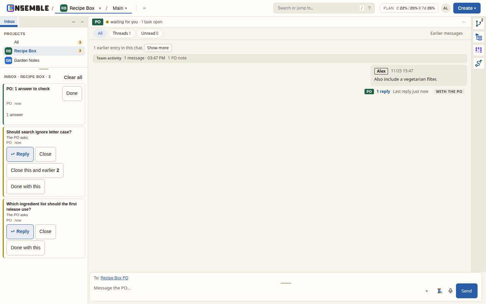

# Ensemble user guide

These pages follow the dashboard as you use it. Every picture shows a fictional demo hub in the Paper theme; no live project or personal account is shown.

| Start here | Work with a project | Keep it running |
|---|---|---|
| [Getting started](getting-started.md) | [Board](board.md) · [Task life](task-life.md) | [Usage and pacing](usage.md) |
| [PO chat and threads](po-chat.md) | [Inbox and Ask cards](inbox.md) · [Files](files.md) | [Notifications and app](notifications.md) |
| [Sessions and terminals](sessions.md) | [Settings and themes](settings.md) | [Remote use and security](remote-security.md) |
| [Troubleshooting](troubleshooting.md) | [Restart, update and backup](maintenance.md) | [Contributor guide](developer.md) |

