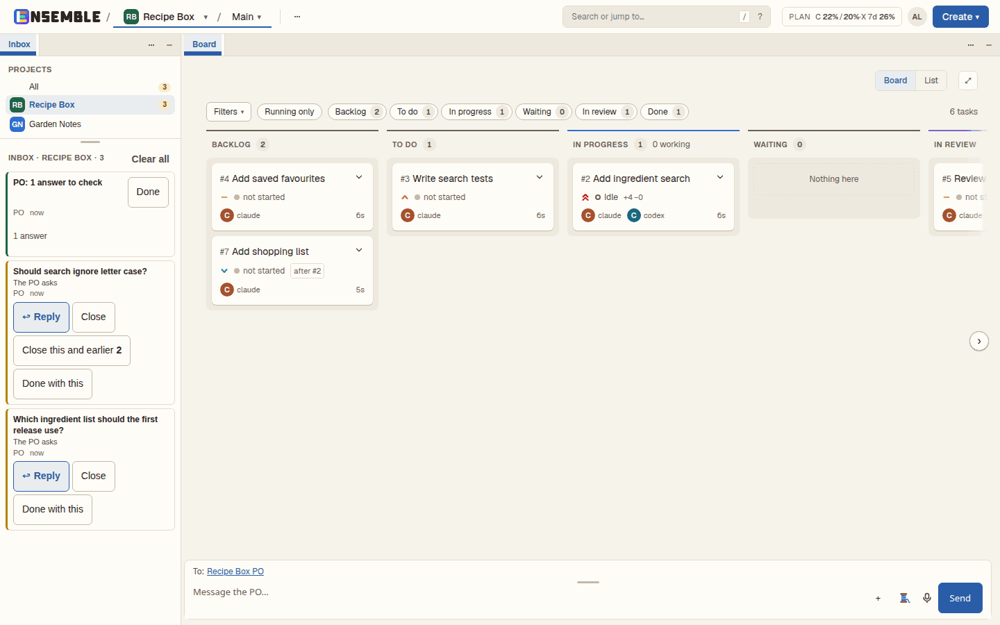
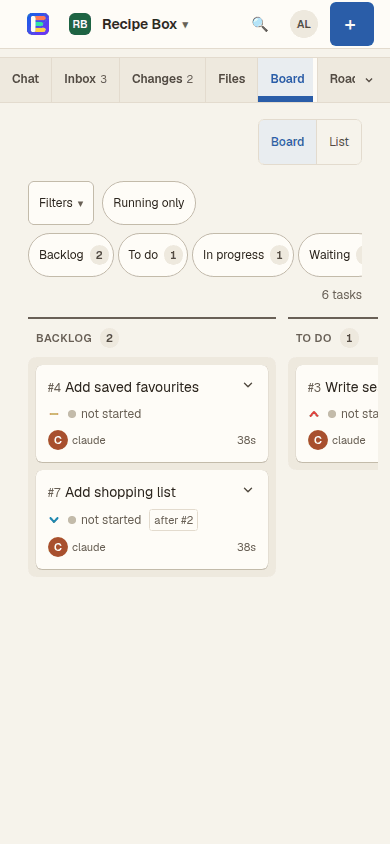

# The board

## What it is

Each project has a board for its tasks. A card's column is its chosen workflow stage: **Backlog**, **To do**, **In progress**, **Waiting**, **In review** or **Done**. Its live status is separate, so a task can be stopped while its card stays in In progress. A priority and task number make it easier to find.

## How to find and move work

1. Select a project in the sidebar and open its **Board** panel. Switch between **Board** and **List** above the tasks.
2. Select a task card to read its spec, agents, priority and activity. Use the task's controls to change its priority or workflow column.
3. Keep work that is still being shaped as a **draft** in Backlog. Starting a task launches its chosen agents; a draft has no running session.
4. If one task depends on another, tell the PO to set **Start after** on the dependent task. The hub can start it when the earlier task is ready; the card shows its gate.

