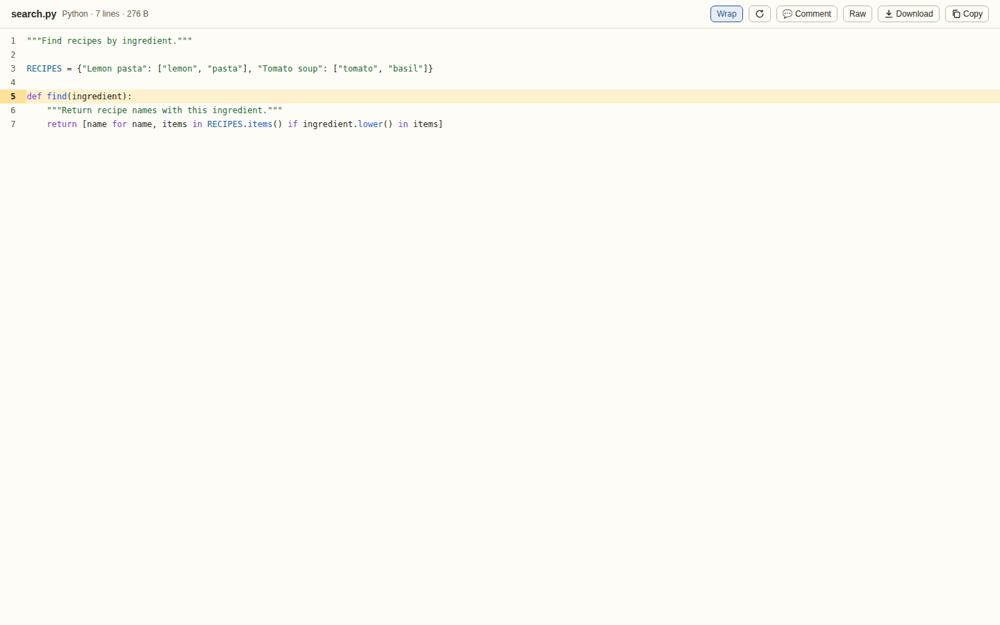
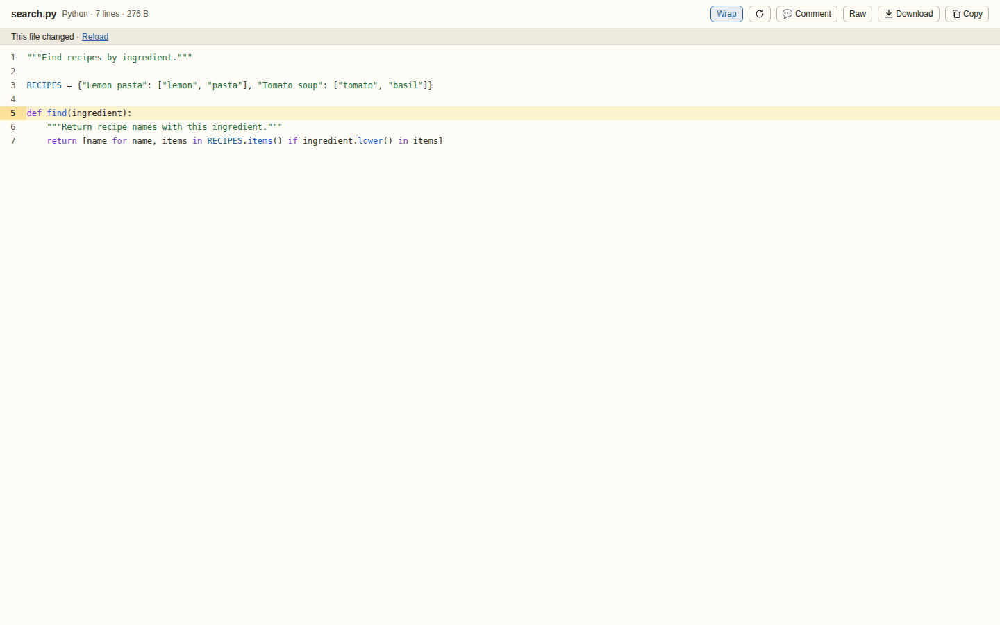

# Files and the file viewer

## What it is

The file viewer opens project files from the Files panel or a file link in a message. It shows line numbers, a comment control and ways to send a selection to the PO, a task or a thread.

## How to read and comment on a file

1. Open **Files** in a project, or select a file link in a chat message. Choose a file to see it with line numbers.
2. Select the lines you want to discuss and use **Comment**. Choose **Send to** for the main PO chat, an existing thread, a new thread or a task, then send your note.
3. If the file changes while the viewer is open, use **Reload** when the **This file changed** notice appears. Recheck line numbers before commenting on the new version.

