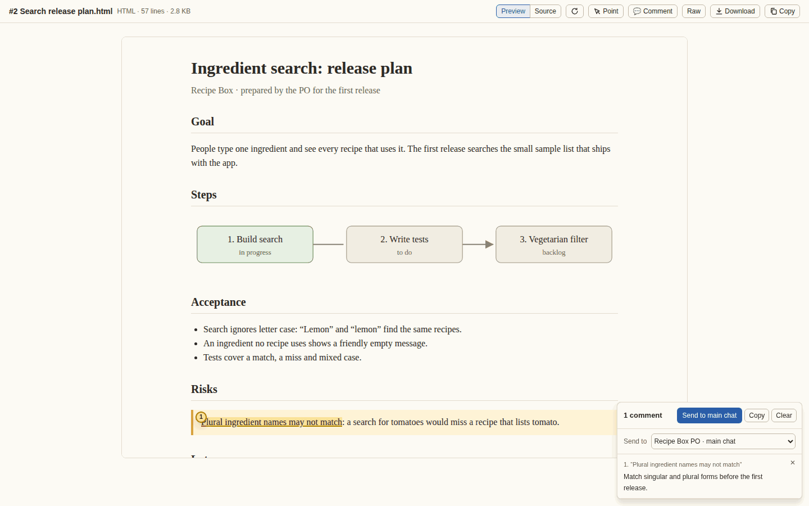

# Files and the file viewer

## What it is

The file viewer opens project files from the Files panel or a file link in a message. A source file shows with line numbers; an HTML page, such as a plan or report an agent wrote, opens rendered as a page. Either way you can comment on a passage and send your notes to the PO, a task or a thread.

## How to read and comment on a file

1. Open **Files** in a project, or select a file link in a chat message. Choose a file to open it.
   On a computer, a file link in a chat (the PO's, a thread, a task's, or a card in them) opens the file as a panel at the right of the conversation, as Files does; a file already open there comes to the front, at the line the link names. Ctrl-click (⌘-click on a Mac) or middle-click a link to open it in a new browser tab instead. On a phone, and for a file that is not there yet or a folder, the link opens in a new tab.
2. An HTML page opens in **Preview**: it is shown sandboxed, with its scripts off. Use **Source** to see its markup with line numbers.
3. Select the passage or lines you want to discuss and use **Comment**, then write your note. The passage stays highlighted with a number, and the note waits in the comment tray, so you can add more before sending.
4. Choose **Send to** for the main PO chat, an existing thread, a new thread or a task, then send your notes together.
   In a file panel beside a conversation, **Send to** starts on the conversation on screen: the thread you are reading, or the main chat when no thread is open. It follows you when you open another thread or go back to the main chat. Once you pick a place yourself, that place stays for as long as the panel is open. A file in its own browser tab keeps the place you picked for it, as before.
5. A page or a picture takes the width of the panel or window it is shown in, and follows it as you resize. It is never narrower than 320 pixels (in a narrower panel it scrolls sideways) and never wider than 1600 pixels (in a wider window it stays centred). A picture is never shown larger than its own size unless you zoom it.
6. If the file changes while the viewer is open, use **Reload** when the **This file changed** notice appears. Recheck the passage before commenting on the new version.

## Zoom a file on its own

Use **−** and **+** in the file's bar to make the file bigger or smaller without zooming the rest of Ensemble; click the percentage to go back to 100%. Ctrl (⌘ on a Mac) with the mouse wheel over the file, or Ctrl/⌘ with **+**, **−** and **0**, do the same, and on a touch screen two fingers on the file zoom it. A diff in **Changes** has the same control in its bar. The level is remembered on this device for each kind of file: pages, Markdown, code and text, pictures and diffs. A PDF uses the browser's own viewer and its zoom.

## Where the agents' work is kept

Every project has a home folder in the hub's projects folder, `~/EnsembleProjects/<project>/` by default (you can choose another projects folder in the setup wizard or Settings, before the first project is created). Agents write their documents there rather than leaving them in a chat:

| Path | What it holds |
|---|---|
| `Documents/` | Reports, plans and design notes, named after their task, such as `#12 Search release plan.html` or `.md`. Open it from the project's Workspace (under **Tasks & notes** when the project's code lives elsewhere). |
| `ROADMAP.md`, `PO-HANDOVER.md` | The PO's plan for the project and its notes for the next PO session |
| One folder per task | `TASK-HANDOVER.md` (the owner's state when a session hands over) and `REVIEW-LOG.md` (every review verdict); a code task's checkout is its `repo/` folder |

Because these are plain files, you can read them in any editor as well as in the viewer, and [back them up](maintenance.md) to a Git remote of your own.
