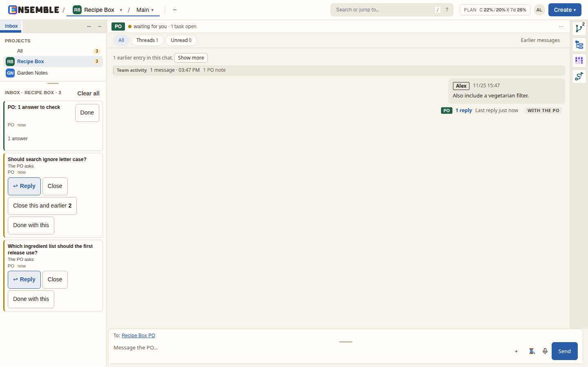

# Getting started

## What it is

The hub is one program on your computer. It keeps its settings in `~/.ensemble`, creates projects under `~/EnsembleProjects`, and serves the dashboard at `http://127.0.0.1:8765`. The agents are the Claude Code and Codex programs already installed and signed in on that computer.

## How to install and open it

1. Install Python, Git, and at least one agent CLI (`claude` or `codex`); sign in with that CLI.
2. Clone this repository. On Linux run `./install-systemd.sh`; on macOS run `./ensemble start`; in Windows PowerShell run `.\ensemble.ps1 start`.
3. Open `http://127.0.0.1:8765` on the hub computer. On Linux, `./install-systemd.sh status` checks the service; macOS uses `./ensemble status`; Windows uses `.\ensemble.ps1 status`.

## How to make your first project and task

1. Open **Create** in the top bar and choose a project. Give it a name and choose a code or documents project.
2. Select the project in the left sidebar. Make or select its PO conversation; the PO is the agent you talk to about priorities and requirements.
3. Tell the PO what you want in the chat box. It can create draft tasks with a spec, owner and reviewer.
4. Open **Board** to inspect the drafts, then start a task when its scope is ready. [The task life](task-life.md) explains the rest.
