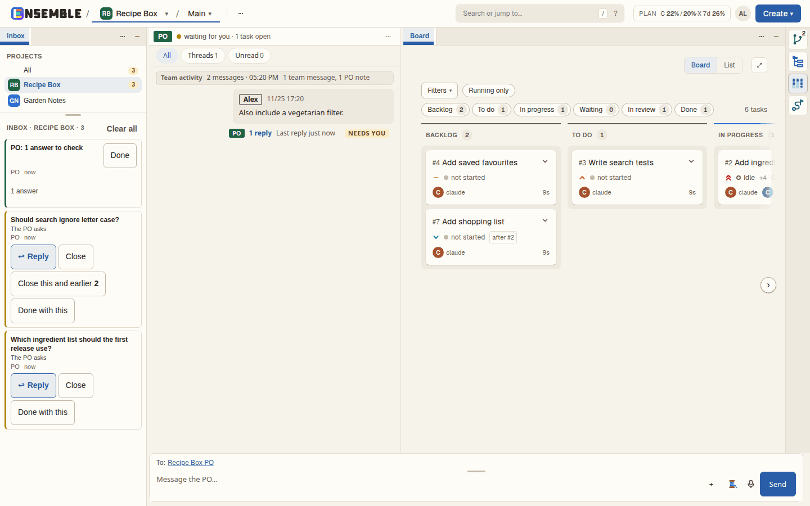

# Inbox and Ask cards

## What it is

The Inbox gathers work that needs your attention: unanswered questions, task decisions and other items. An **Ask** card presents choices or Yes/No, sometimes with a recommended option. Open cards remain until answered or closed.

In a chat, a card arrives in one balloon with its explanation: what the agent wrote just before asking, why it asks, and what it wrote just after, with the card under them. The agent's next words join the same balloon when they arrive, so the reason never comes later as a message of its own. In a threaded PO chat the card and those words are always in the same thread.

## How to answer or close a card

1. Open **Inbox** from the project's sidebar or panel. Select **Reply** on the card to open the question in its chat with the message box aimed at it.
2. In the chat, pick an option or **Yes**/**No**. Add a comment if the choice needs context, then send the answer.
3. If the question is no longer relevant, choose **Close**. **Close this and earlier** clears that card and older cards in the same group. **Done with this** marks an answer-to-check item handled. The conversation remains available.

