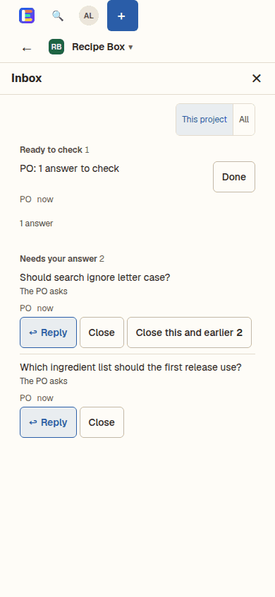

# Inbox and Ask cards

## What it is

The Inbox gathers work that needs your attention: unanswered questions, task decisions and other items. An **Ask** card presents choices or Yes/No, sometimes with a recommended option. Open cards remain until answered or closed.

## How to answer or close a card

1. Open **Inbox** from the project's sidebar or panel. Select the item to see its question in context.
2. Pick an option or **Yes**/**No**. Add a comment if the choice needs context, then use **Reply**.
3. If the question is no longer relevant, choose **Close**. A closed card no longer waits for your answer; the conversation remains available.

