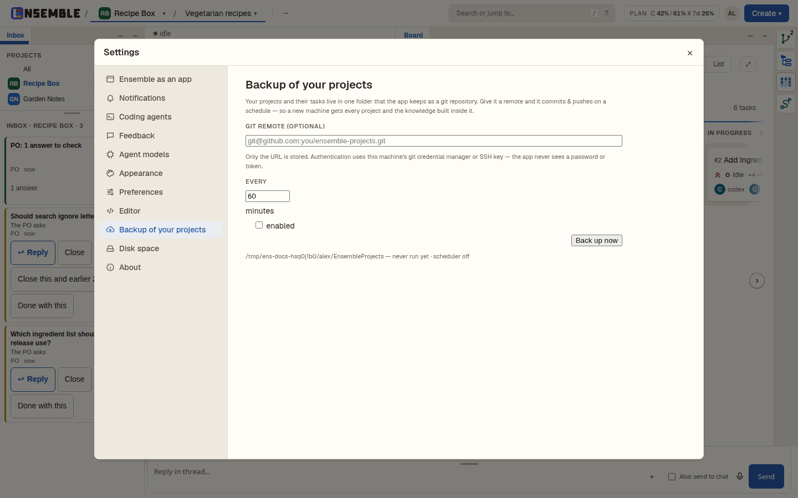

# Restart, update and backup

## What it is

The hub can restart its own process safely, update an installed build and back up project folders. A restart temporarily pauses sessions and brings them back; a code update changes the version running on the hub computer.

## How to maintain the hub

1. When an update is available, open the avatar menu and choose **What's new · Update available**. Use **Update now** there and read the confirmation; the hub restarts after updating.
2. For a plain restart of a Linux systemd installation, run `systemctl --user restart ensemble`. On macOS use `./ensemble restart`; on Windows use `.\ensemble.ps1 restart`.
3. Open **Settings** → **Backup of your projects** to choose a backup destination and check its status. Use **Back up now** for an immediate run.

Keep the project repository's own Git remote and your backup destination under your control. A backup is a separate copy of project files, not a substitute for reviewing agent changes.
