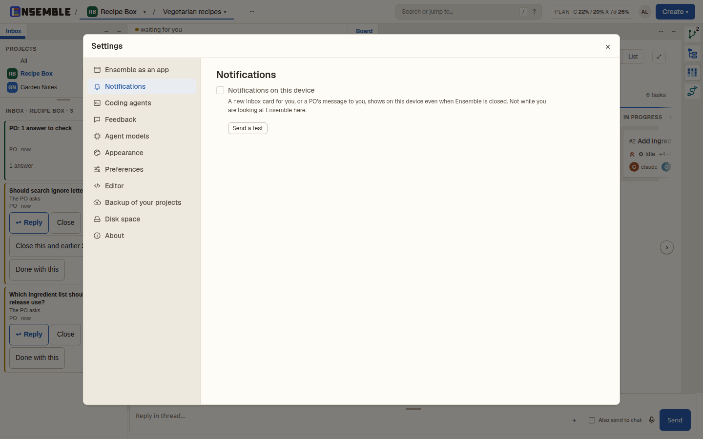

# Notifications and the app

## What it is

The hub can notify your devices about questions and work that needs you. You can also open Ensemble as an app window on a computer or add it to an iPhone home screen.

## How to set them up

1. Open the avatar menu, then **Settings** → **Notifications**. Turn on **Notifications on this device** and allow the browser's permission request. Use **Send a test** to check it; the device list shows where notifications are on.
2. On a remote device, use the hub's HTTPS address from [Tailscale Serve](remote-security.md#how-to-add-https-with-tailscale-serve). A plain HTTP tailnet address cannot register for push.
3. On an iPhone or iPad, open that HTTPS address in Safari, use **Share** → **Add to Home Screen**, open Ensemble from the new icon, then turn notifications on there. A Safari tab cannot receive Web Push for this site.
4. For a desktop app window, open **Settings** → **Ensemble as an app** and choose **Install app** when your browser offers it. Safari on a Mac uses **File** → **Add to Dock**.
