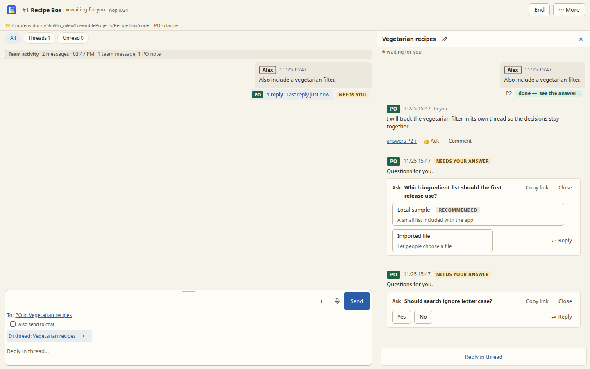
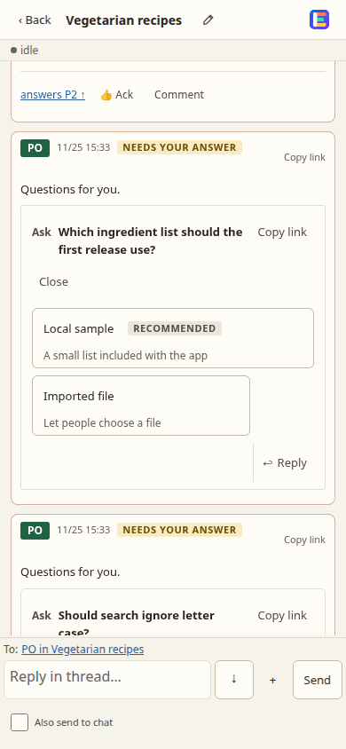

# PO chat, threads and points

## What it is

The project's PO chat is where you discuss work. A message can become a numbered point, such as P12, so it remains visible until answered. Threads keep one topic together; comments on a passage can link back to the exact message.

## How to discuss a change

1. Select the project and open **PO chat**. Type a request in **Message the PO** and send it.
2. Use **Threads** to open an existing topic or start a new one; name it if the subject needs a clearer label. On a computer the project's latest threads are also listed under it in the Projects panel on the left: click one to show it, or Ctrl/Cmd-click to open it as a tab. On a phone they are under the project in the project menu.
3. Open a point's link to see its stage. The PO may mark it planned, then delivered when the work is ready. Acknowledge a delivered answer when it addresses your request.
4. To discuss part of a message, select or use its comment control, write your note and send it in the relevant thread.

