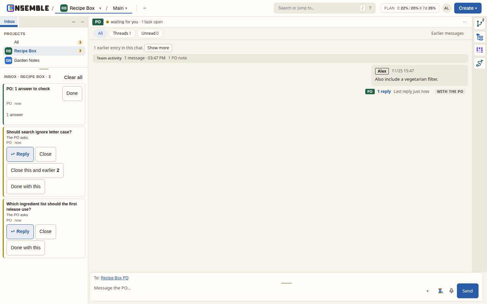

# Remote use and security

## What it is

The hub listens on the hub computer. A private tailnet lets a Mac or phone reach it without making the dashboard public. Remote browsers must sign in with the hub's access token; the token is stored on the hub machine in `~/.ensemble/access-token.txt`.

## How to connect through a tailnet address

1. Install Tailscale on the hub and the device you will use. Join both to the same tailnet.
2. Tell the hub to bind to its Tailscale address before starting it. On Linux, run `ENSEMBLE_BIND=tailscale ./install-systemd.sh`; this updates and restarts the user service. On macOS, stop an existing hub with `./ensemble stop`, then run `ENSEMBLE_BIND=tailscale ./ensemble start`. In Windows PowerShell, stop an existing hub with `.\ensemble.ps1 stop`, set `$env:ENSEMBLE_BIND='tailscale'`, then run `.\ensemble.ps1 start`.
3. Open `http://<hub-tailnet-name>:8765` on the remote device. If it asks for a token, copy the token from `~/.ensemble/access-token.txt` on the hub computer and paste it into the sign-in page. Keep it private.

## How to add HTTPS with Tailscale Serve

HTTPS is needed for remote push notifications and browser app installation. Serve proxies to the hub's loopback address; the hub may keep its default loopback bind for this route.

1. In the Tailscale admin console, enable **MagicDNS** and **HTTPS Certificates** for the tailnet.
2. On the hub computer, run `tailscale serve status`. Pick HTTPS port 443 if it is unused, otherwise a free port such as 8443. On Windows, use an Administrator terminal for Serve.
3. Run `tailscale serve --https=443 --bg 8765` (substitute your chosen HTTPS port). Confirm with `tailscale serve status`.
4. Open the HTTPS address from the remote device and sign in with the token when asked. To remove this address later, use `tailscale serve --https=443 off` with the port you chose. Avoid `tailscale serve reset`, which removes every Serve address on that machine.

Use Serve's HTTP or HTTPS proxy mode, not its raw TCP modes, so the hub can distinguish proxied requests and require the token.
