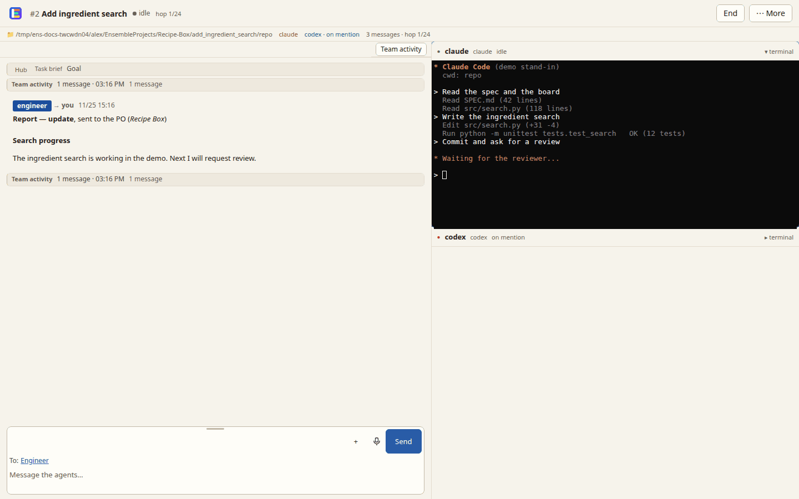

# Sessions and terminals

## What it is

Each running task has a session page with its chat, agent state and a live terminal. The session keeps the task's messages and links to its files and reports.

## How to open and use a session

1. Select a task card or its link in a report, then open **Session**.
2. Read the messages to see the owner's progress and reviewer feedback. Open the terminal panel to see the agent's live output.
3. If the session has stopped, type in its message box and send to resume it with your instruction. Check the task state before sending a second message.

