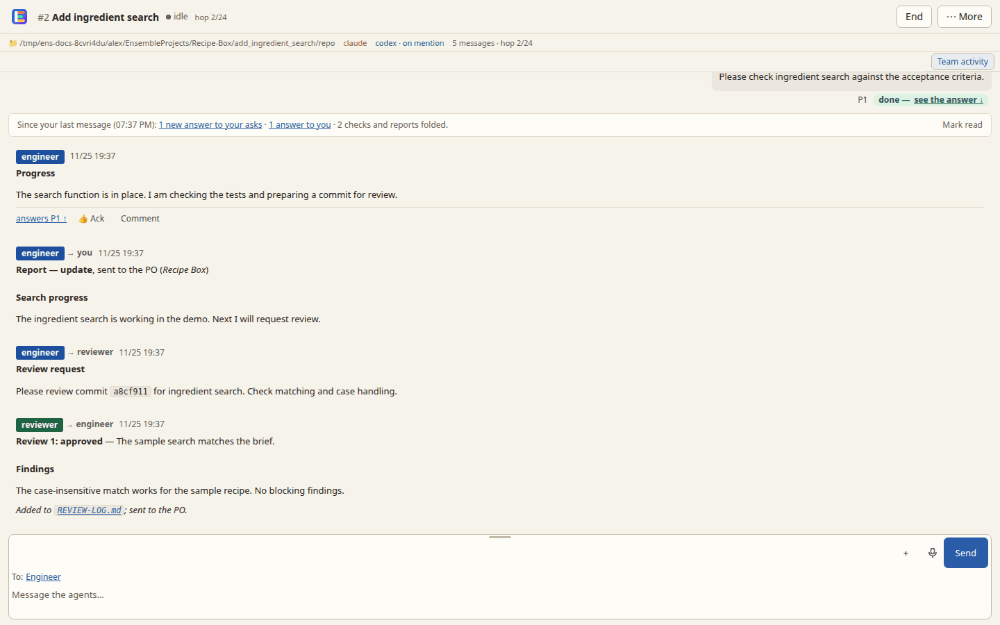
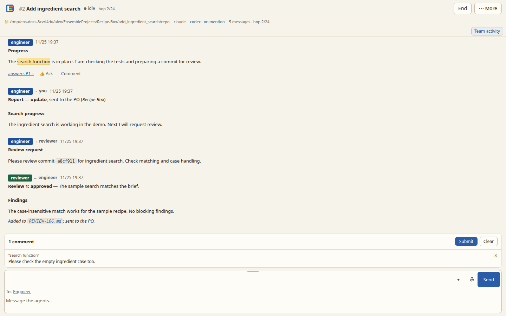
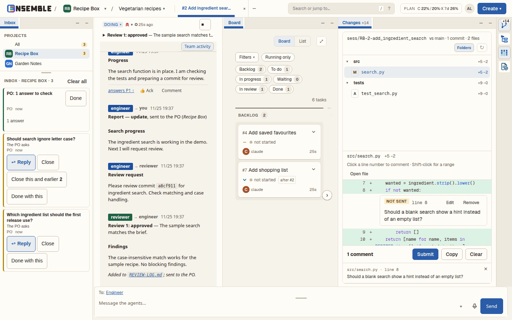
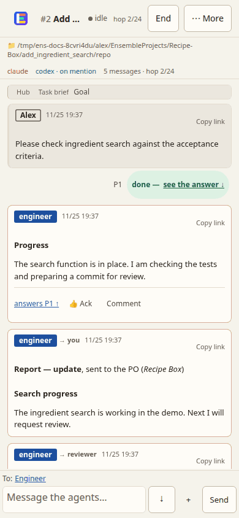

# Sessions and terminals

## What it is

Each running task has a session page with its chat, agent state and a live terminal. The session keeps the task's messages and links to its files and reports.

## How to open and use a session

1. Select a task card or its link in a report, then open **Session**.
2. Read the messages to see the owner's progress and reviewer feedback. Open the terminal panel to see the agent's live output.
3. If the session has stopped, type in its message box and send to resume it with your instruction. Check the task state before sending a second message.

Select part of an agent message to add a review comment. The selected passage stays highlighted while your comment waits in the tray.

## Review a task's code in the hub

A code task's side rail has **Changes**: the diff of the task's branch against `main`, from where the branch started. The head line shows the branch and how many commits and files it has; **Folders** groups the files into a tree, and you can read a file's diff unified or side by side.

1. Open the task and choose **Changes** on its side rail. Select a file to see its diff.
2. Click a line number to comment on that line, or Shift-click a second number for a range (on a phone, tap the line). Write your note; it waits in the comment tray, marked **NOT SENT**, while you add more.
3. Use **Submit** to send all the notes to the task's chat as one set of review comments for the owner.

The rail's **Files** button opens the task's Workspace: browse its folder, search file names, or switch to text search for content (with regular-expression and match-case options). All of this works from any browser that can reach the hub, a phone included; see [remote use](remote-security.md).

