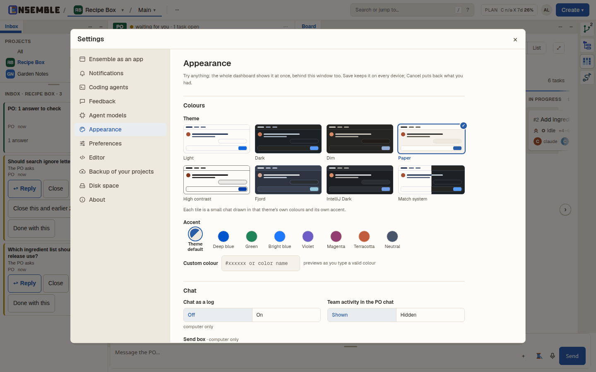

# Settings and themes

## What it is

Settings holds appearance, notifications, agents, editor, backups and other preferences. The appearance choices include Light, Dark, Dim, Paper, Contrast, Fjord, IntelliJ Dark and System.

## How to choose a theme

1. Open the avatar menu and choose **Settings** → **Appearance**.
2. Choose a theme tile; the dashboard previews it immediately. **Paper** is the warm, light theme used throughout this guide.
3. Adjust the available accent or text choices if you want, then choose **Save**. **Cancel** returns to the earlier appearance.
