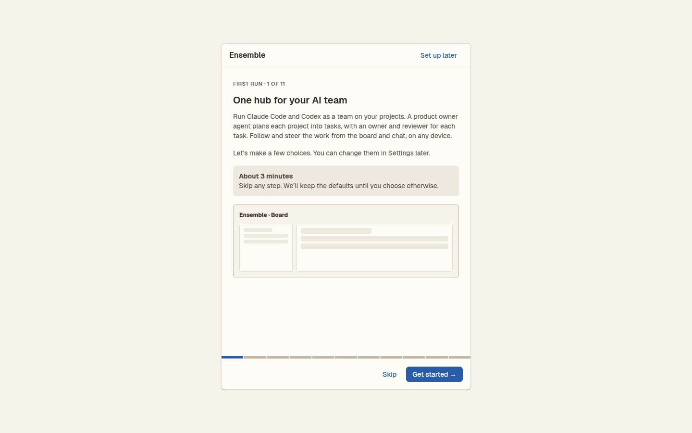
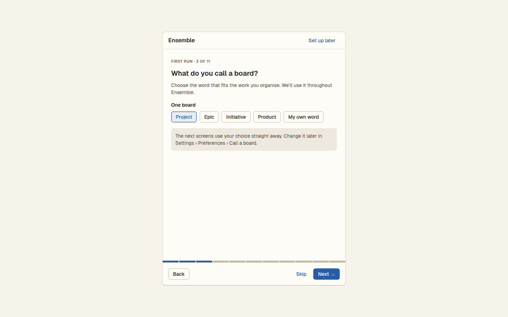
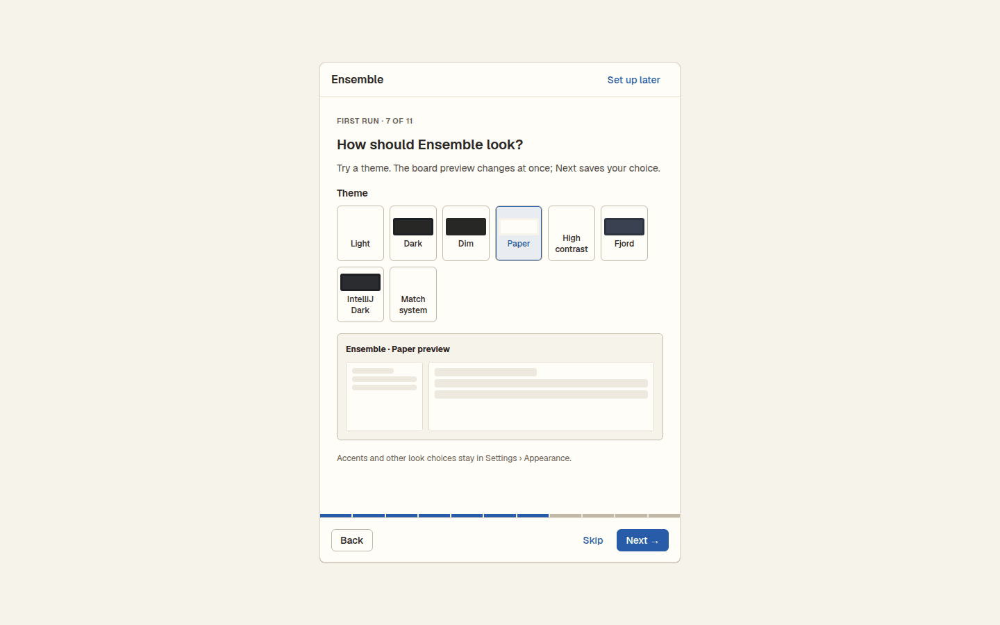
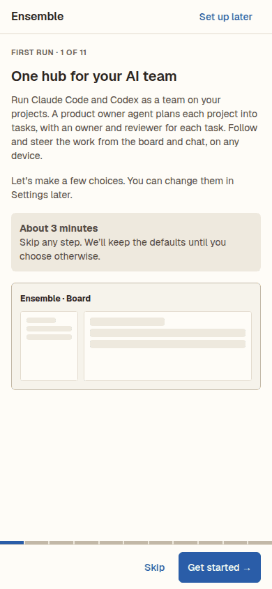

# First-run setup wizard

On a new install with no projects, Ensemble opens a short setup wizard when you load the dashboard. It introduces the hub and walks through the choices that shape your workspace. Existing installs do not see it automatically. You can open it later with **Settings → Run setup again**.

The wizard checks which Claude Code and Codex CLIs are installed and signed in. It then asks what to call a board (Project, Epic, Initiative, Product, or your own word), checks the detected plan sizes, and offers a preferred agent line-up and weekly pacing. You can choose a projects folder, theme, notifications for this device, remote use over your tailnet, and start at sign-in where supported. The last choice is an optional first project and PO agent.

Each saved choice uses the same setting or device notification control as Settings. **Skip** keeps the current value. Remote use takes effect after the next hub launch; start at sign-in is available only for a supported installed app. The final screen lets you create the named project or open the board without one.

**Set up later** closes the wizard and marks setup done. Use **Settings → Run setup again** to return.

## How to use it

1. [Install and open Ensemble](getting-started.md). On a new hub with no projects, the Welcome screen opens automatically. Select **Get started**.
2. Check the coding agents. Install or sign in to at least one CLI if needed, then choose **Check again**.
3. Choose your board word, plan sizes, line-up and pacing, projects folder, and theme. Select **Next** to save each choice, or **Skip** to keep its current value.
4. Choose whether to enable notifications, remote use, and start at sign-in. Follow the prompts available on this device.
5. Optionally name your first project and select a ready PO agent. On the final screen, choose **Create project** to make it, or **Open board** to start without one.
6. To revisit these choices, open **Settings** and select **Run setup again**. The values you see there are the same ones used by the wizard.

