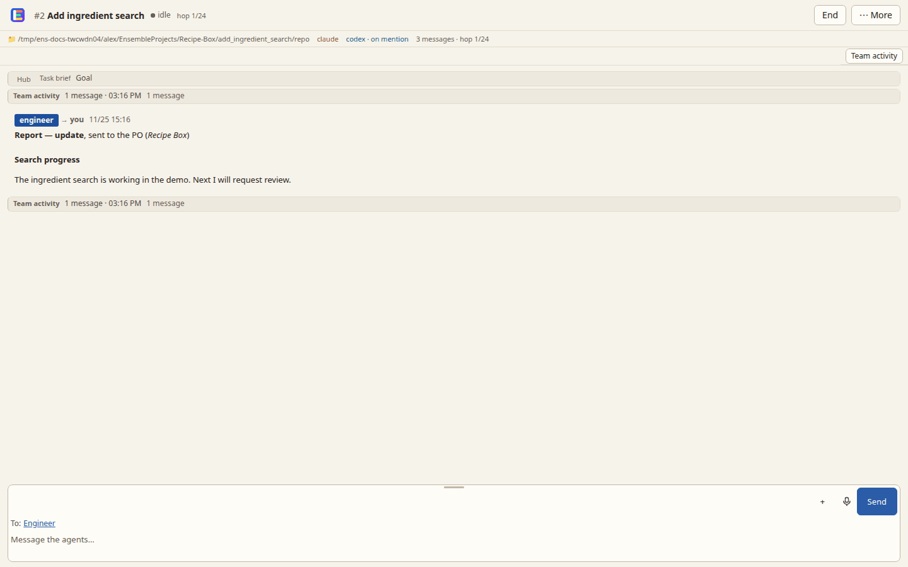

# A task's life

## What it is

A task begins with a written spec. Its owner does the work in a task workspace; an optional reviewer checks a commit when the owner asks. The owner sends a completion, blocker or question report to the project PO. In a code project, the PO merges the branch and the card reaches Done when the merge is seen. A documents project has no merge, so its card can be moved to Done directly.

## How to follow a task

1. Open a draft card and read the spec, priority and preferred owner/reviewer. Start it when the instructions are ready.
2. Open the task's **Session** to see its conversation and terminal. The owner makes a commit and sends that commit to the reviewer; the reviewer runs for that review, then gives a verdict.
3. Read the owner's report in the PO chat and open the task from its task-number link. If changes were requested, follow the next commit and review round.
4. After acceptance, merge the code branch in the project's repository. The hub detects that merge and moves the task to Done.

When a conversation grows long, the owner writes a handover and a fresh session continues from it. The task and branch stay the same.
