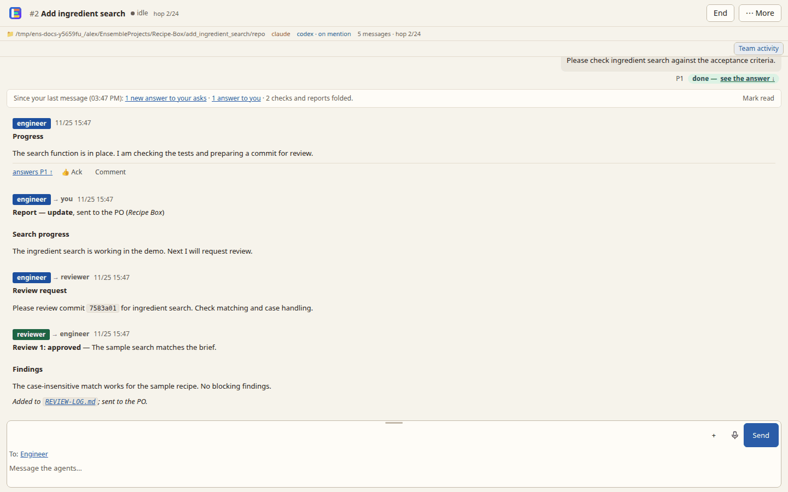

# Troubleshooting and FAQ

## What it is

Most startup problems are a missing agent login, a stopped hub service or a browser that has not signed in. The task and project pages show their current state; the hub log gives startup and launch errors.

## How to check common problems

1. **The dashboard will not open:** check a Linux service with `./install-systemd.sh status` (or `systemctl --user status ensemble`), a macOS hub with `./ensemble status`, or a Windows hub with `.\ensemble.ps1 status`. Read `~/.ensemble/logs/ensemble.log` on Linux, `~/Library/Logs/ensemble.log` on macOS or `%USERPROFILE%\.ensemble\logs\ensemble.log` on Windows.
2. **An agent will not start:** run `claude --version` or `codex --version` on the hub machine, sign in with that CLI, then retry the task.
3. **A remote device asks for a token:** get it from `~/.ensemble/access-token.txt` on the hub machine. Check that the device is on the same tailnet.
4. **A card looks idle after a restart:** open its session and read the live indicator. Workflow columns describe the chosen stage; they are separate from whether a process is running.
5. **A file changed while you were reading:** use **Reload** in the file viewer and check the lines again.
