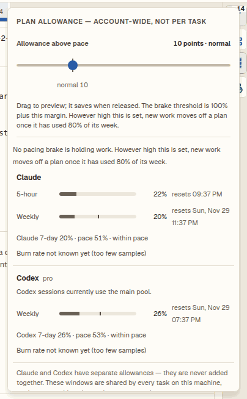

# Usage and pacing

## What it is

The top bar's plan chip shows the hub's latest Claude and Codex allowance readings. The hub uses them when selecting a task's owner and reviewer from the preferred line-up, while preserving a human choice to keep particular agents.

## How to read it

1. Find **Plan** in the top bar. Open it for the available windows and their reset times. A missing reading is shown as unavailable, not as zero usage.
2. Before starting a task, read its preferred line-up and the allocation reason on the task. The hub may swap Claude and Codex if one is close to its pace limit.
3. If the choice must stay fixed for a particular task, use **Keep these agents** in that task's menu.

## How Ensemble saves tokens

Every model call re-sends the whole conversation, so a long session costs more with each turn. The hub keeps sessions short and wakes agents only when there is work:

- **Handovers.** When a task owner's conversation reaches 200,000 tokens, the owner writes `TASK-HANDOVER.md` and a fresh session carries on from it, on the same task and branch. The PO does the same at 150,000 tokens with `PO-HANDOVER.md` and `ROADMAP.md`. Change the limits in **Settings** → **Agent models** → **Handover** (**Hand a task session over at**, **Hand the PO over at**; at least 100,000, 0 turns it off). A session still working 30,000 tokens past its limit is handed over by the hub.
- **Reviewers on demand.** A reviewer starts only when the owner sends it a commit to review, as a fresh session that reads the spec, the diff and the review log, then stops after its verdict.
- **Progress checks without a model call.** Every few minutes the hub compares each task's facts (status, column, commits, blockers) with what the PO was last told. If nothing changed, nobody is woken and no model runs. If something changed, a cheap model (Haiku) writes the PO a short digest.
- **A cheap reader for searches.** With **Settings** → **Preferences** → **Command output** → **Cheap reader for task owners** on, a task owner can hand "where is X, how does Y work" sweeps to a Haiku helper that can only read and search files, and gets back short file-and-line answers. It is off by default, is offered to task owners only, and applies from each session's next launch. A Codex owner gets it too when Claude Code is installed.
- **Weekly pacing.** With **Settings** → **Agent models** → **Weekly pacing** (**Pace each agent's week**, on by default), the hub gives a new task's ownership to the agent with more allowance to spare this week. When both are forecast to run past their week, new work of medium priority or lower waits until there is room.
